<div align="center">

# PayMaster

### An AI accounts-payable agent that can read invoices, but can never be talked into paying one.

[](#testing-and-evaluation)
[](tests)
[](https://paymaster.synteron.dev/console/login.html)
[](LICENSE)
[](https://github.com/SabhyataC/paymaster/commits/main)
[](https://github.com/SabhyataC/paymaster)
[](https://github.com/SabhyataC/paymaster/search?l=python)
[](Dockerfile)
[](backend/webhooks.py)
[](db/schema.sql)
[](backend/paypal_client.py)
[](backend/investigator.py)
[](Dockerfile)
[](docs/devpost.md)

**[Live demo](https://paymaster-qip6.onrender.com/console/login.html)** · **[Architecture](#architecture)** · **[Demo guide](#try-it-in-five-minutes)** · **[Evaluation](#testing-and-evaluation)** · **[Operations guide](docs/operations.md)**

</div>

> **All data is SYNTHETIC and every payment runs in the PayPal sandbox (fake money).** No real company, person or bank account is represented.

---

## Why this exists

Small finance teams pay invoices from email. One changed bank detail or one convincing fake invoice and the money is gone. AI tools that read invoices make this worse, because a clever PDF or email can *talk* the model into approving it (prompt injection).

PayMaster is built on one rule: **the AI may suggest, but code and people decide.**

- The AI reads and investigates. It cannot reject, cannot approve a held invoice, and cannot choose which company's data it sees.
- **Only a hard check can reject.** The AI can only escalate to "hold for a person".
- **Only a named person with a written reason can release a hold.**
- **A retry can never pay twice.** Every payout is saved with an idempotency key before PayPal is contacted.
- **Every decision is in a tamper-evident audit log**, and the Trust Graph shows, link by link, the evidence behind a payment.

A hostile AI that approves everything still cannot get a bad invoice paid. We test exactly that (see [Evaluation](#testing-and-evaluation)).

## Highlights

| | |
|---|---|
| **Safe by construction** | Hard checks, fraud signals and an investigator agent in three layers. The AI can never be looser than the code. |
| **Real PayPal money flow** | PayPal Payouts with idempotency keys, signature-verified webhooks, returns and refunds reversed in the ledger. |
| **Provable books** | Balanced double-entry ledger, append-only by database trigger, with reconcile against PayPal. |
| **Tamper-evident audit** | Append-only audit log with a SHA-256 hash chain that anyone can re-verify from the console. |
| **Explainable** | Trust Graph and investigation report show verified facts and AI suggestions separately. |
| **Multi-tenant and role based** | Per-company data isolation enforced in the database. Roles: admin, reviewer, viewer. |
| **Hosted and demo ready** | One Docker service on Render serves the API and the console. One button loads demo data. |

## Screenshots

<table>
<tr>
<td width="50%"><b>Overview</b>: what needs a person, money stopped before paying, paid out<br>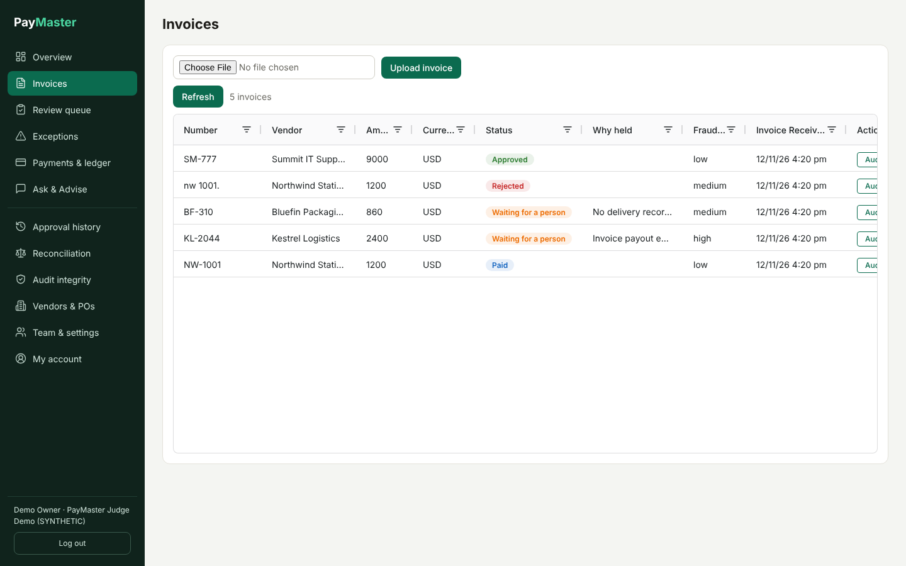</td>
<td width="50%"><b>Review queue</b>: held invoices wait for a named person<br>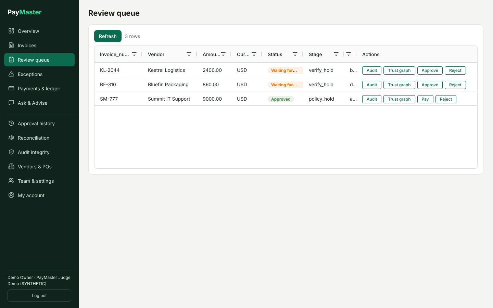</td>
</tr>
<tr>
<td><b>Trust Graph, held invoice</b>: where the evidence chain breaks<br>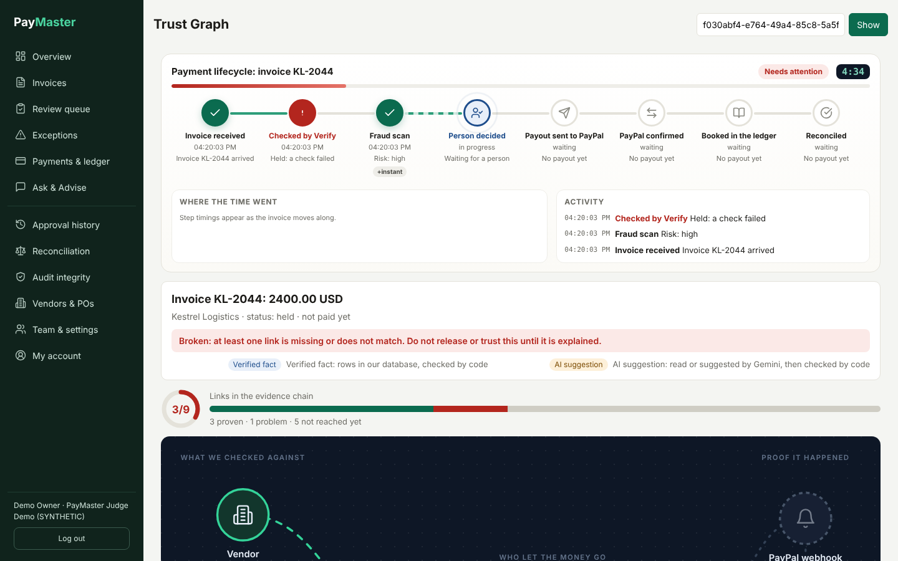</td>
<td><b>Trust Graph, paid invoice</b>: every link proven through the ledger<br>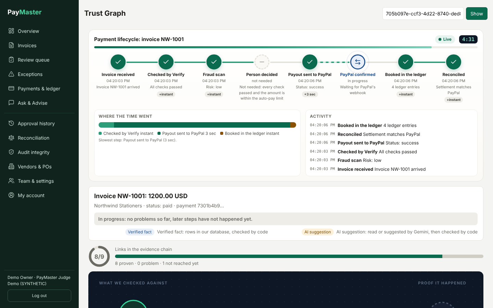</td>
</tr>
<tr>
<td><b>Payments and ledger</b><br>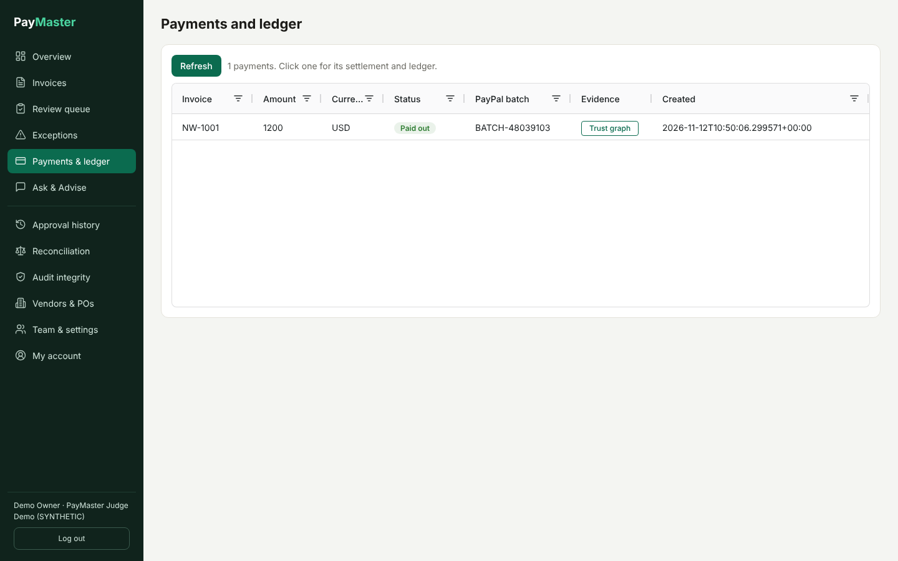</td>
<td><b>Reconciliation</b> against PayPal<br>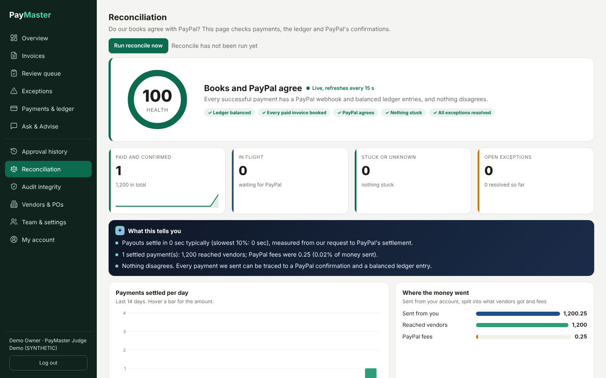</td>
</tr>
<tr>
<td><b>Audit integrity</b>: hash chain verification<br>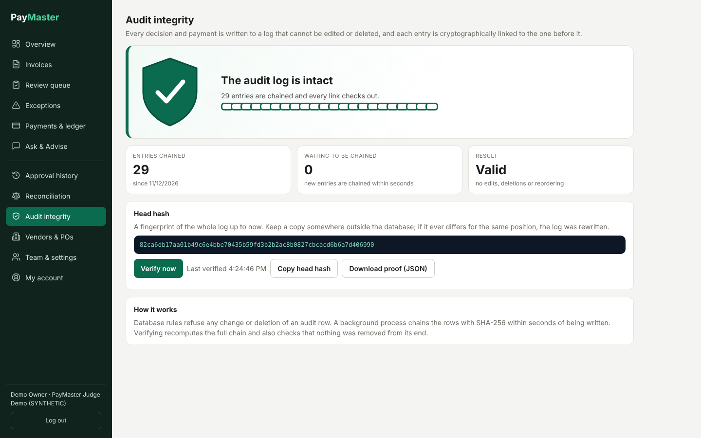</td>
<td><b>Approval history</b><br>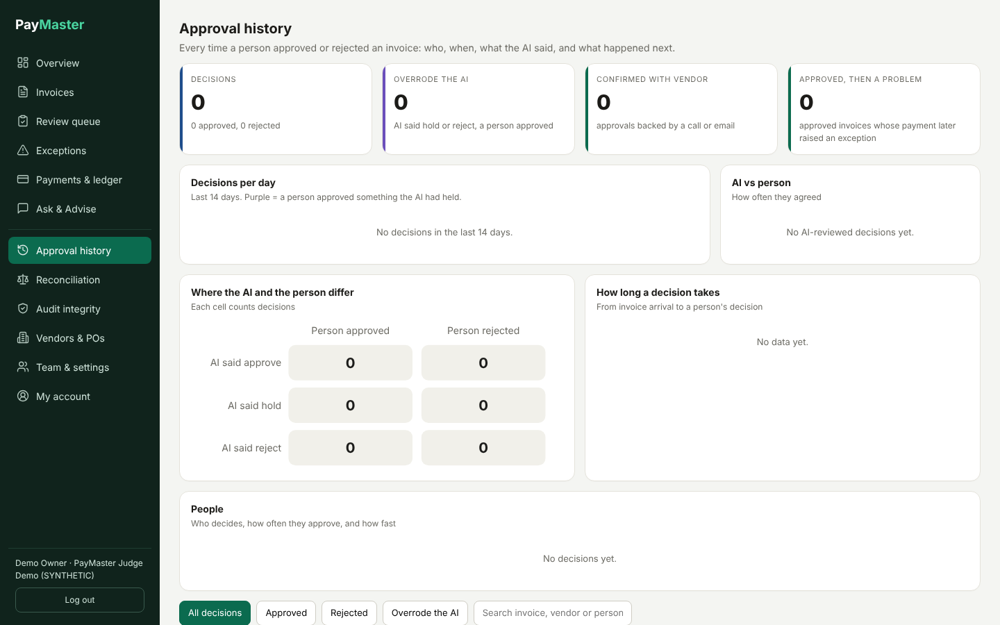</td>
</tr>
</table>

## Try it in five minutes

1. Open the **[live console](https://paymaster.synteron.dev/console/login.html)**. The free Render plan sleeps, so the first load can take about a minute.
2. Sign in with the shared demo login from the Devpost submission (a pre-loaded synthetic company), or sign up and press **Add demo data** on the Team page. Want to use your own data? See the **[user guide](docs/user-guide.md)**.
3. **Review queue**: three invoices are waiting. Open **Trust graph** on the changed-bank-details invoice and see why it was held.
4. Press **Approve**, type a reason of at least 10 characters. A named person is now on the record.
5. Open the clean invoice (`NW-1001`) and see the **Trust Graph** end to end: invoice, Verify, fraud scan, person, PayPal payout, webhook, ledger, reconciled.
6. **Payments and ledger** shows the balanced double-entry rows. **Audit integrity** re-verifies the hash chain. **Reconciliation** compares our books with PayPal.
7. The over-limit invoice (`SM-777`) was approved by Verify but **Pay** holds it by policy until a person releases it.

Judges: everything above is synthetic and runs in the PayPal sandbox.

## Features

### 1. Intake: Gemini reads the document

PDFs, scans and emails become structured fields. Anything below 0.8 confidence goes to *needs review* and never reaches the invoice table. Uploads are validated by content (real PDF/PNG/JPG/text, size and page limits, no scripts or embedded files).

### 2. Verify: three layers, the AI can never be looser than the code

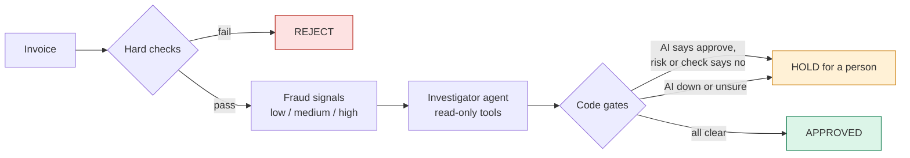

- **Hard checks** ([`checks.py`](backend/checks.py)): PO exists and belongs to this vendor, goods delivered, amount within 2% of the PO, quantity not over-billed, duplicate invoice (including look-alike spellings), bank details changed. Only these can reject.
- **Fraud signals** ([`fraud.py`](backend/fraud.py)): recent or different bank, amount near the limit, new payee, sender domain mismatch, look-alike vendor name, scam wording, odd hours. High total risk can never end as approve. See [`docs/fraud-signals.md`](docs/fraud-signals.md).
- **Investigator agent** ([`investigator.py`](backend/investigator.py)): a Gemini agent with read-only tools, scoped by code to the invoice's own company. It can escalate, never loosen.
- **If the AI is slow or down, the invoice is held**, never approved.

### 3. Review: a named person, a written reason

Held invoices wait in the review queue. A person can approve or reject with a reason of at least 10 characters. A person can never approve a duplicate, a missing PO or another vendor's PO. Two people cannot decide the same invoice.

### 4. Pay: policy, reserve, send, confirm, book

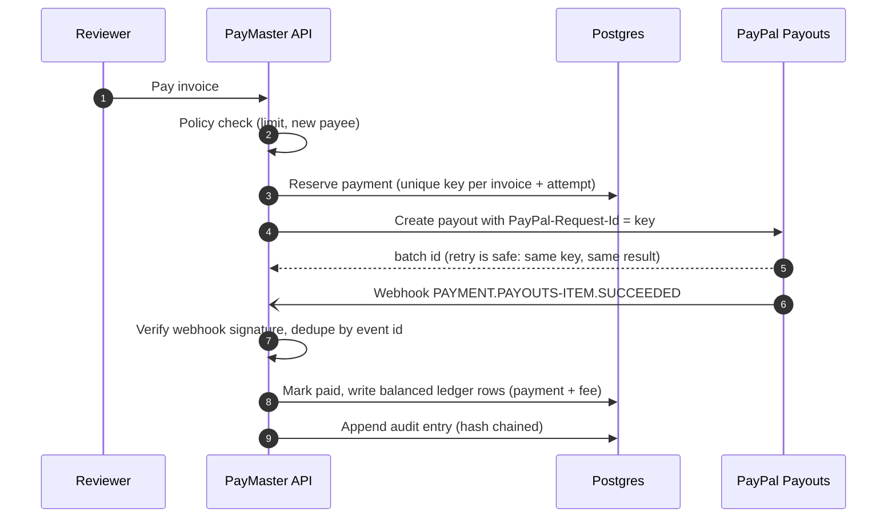

A payment is saved **before** PayPal is contacted. A crash, timeout or double click re-uses the same key, so the payout happens once. Webhooks are verified, de-duplicated and applied in a safe order. If PayPal returns or reverses a payout, mirror ledger lines are appended, the invoice goes back to approved and an exception opens.

### 5. Reconcile: our books against PayPal

Settlements, ledger totals per currency and PayPal's own view are compared. Disagreements (missing webhook, status mismatch, returned money) open exceptions with an AI-written explanation that a person confirms. See [`docs/reconcile.md`](docs/reconcile.md).

### 6. Trust Graph and investigation report

For any invoice, a graph of what was checked against what (vendor, PO, delivery, bank history, webhook, ledger), each link marked **Verified fact** or **AI suggestion**, with a live count of proven versus unproven links. A printable investigation report is available for any case.

### 7. Bring your own data

Create a vendor, a purchase order and a delivery, then upload a PDF, scan or email. Step by step in the **[user guide](docs/user-guide.md)**.

### 8. Everything else

Alerts by email and WhatsApp/SMS, ask-and-advise chat over your own data, cash advice, vendors and POs with deliveries and attachments, change approvals for sensitive edits (a vendor's payout email), exceptions queue, team and settings, document correction flow.

## Architecture

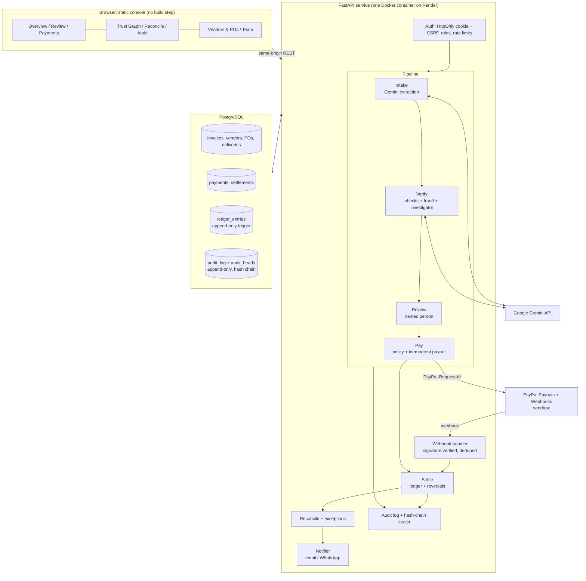

### Application workflow

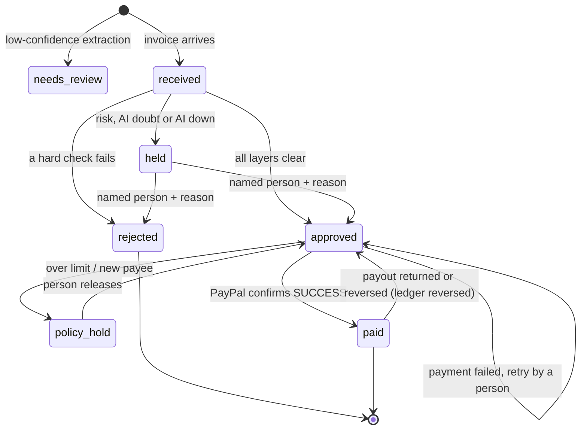

### Data model

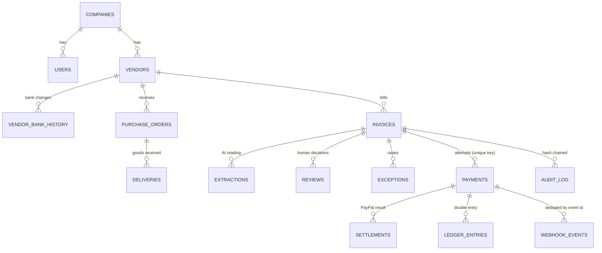

### Technology stack and components

| Layer | Choice | Role |
|---|---|---|
| API | **FastAPI** + Uvicorn | REST API, webhook receiver, serves the console at `/console` |
| Database | **PostgreSQL** | Source of truth; triggers make the ledger and audit log append-only; per-company integrity constraints |
| AI | **Google Gemini** | Document extraction, investigator agent, reconcile explainer, chat |
| Payments | **PayPal Payouts** (sandbox) | Vendor payouts with `PayPal-Request-Id` idempotency, signed webhooks |
| Console | Static HTML/JS, AG Grid | No build step; same-origin API |
| Auth | bcrypt, JWT in HttpOnly cookie, `X-CSRF` header | Sessions, roles, login rate limits stored in the DB |
| Alerts | SMTP, Twilio (or any WhatsApp provider) | Outbox with retry |
| Packaging | Docker, `render.yaml` Blueprint | One service plus one database |

| Module | What it owns |
|---|---|
| `backend/intake.py` | Gemini extraction, confidence gate |
| `backend/checks.py`, `fraud.py`, `investigator.py`, `verdict.py` | The three Verify layers and the final code gates |
| `backend/review.py`, `review_api.py` | Human decisions and their rules |
| `backend/policy.py`, `pay.py`, `idempotency.py`, `paypal_client.py` | Pay stage |
| `backend/webhooks.py`, `settle.py` | Webhook intake, settlement, ledger, reversals |
| `backend/reconcile.py`, `exceptions_api.py` | Reconcile and exceptions |
| `backend/audit.py`, `audit_chain.py` | Audit log and hash chain |
| `backend/trust.py`, `report.py` | Trust Graph and investigation report |
| `backend/auth.py`, `auth_api.py`, `admin_api.py` | Auth, roles, team |
| `backend/demo_data.py` | One-click synthetic demo data |

## API overview

About 70 endpoints, all behind login except `/auth/*` and the PayPal webhook. A selection:

| Area | Endpoints |
|---|---|
| Auth | `POST /auth/login`, `/auth/logout`, `/auth/signup` (off by default), `GET /auth/me` |
| Invoices | `GET /invoices`, `POST /invoices/upload`, `POST /invoices/{id}/reverify` |
| Review | `GET /review/queue`, `POST /review/{invoice_id}/decision` |
| Pay | `POST /review/{invoice_id}/pay`, `GET /payments`, `GET /payments/{id}`, `GET /ledger` |
| Webhook | `POST /webhooks/paypal` |
| Reconcile | `GET /reconcile/status`, `POST /exceptions/{id}/explain`, `POST /exceptions/{id}/resolve` |
| Audit | `GET /audit/{ref}`, `GET /audit/chain/verify` |
| Trust | `GET /trust/invoice/{ref}`, `GET /report/invoice/{ref}`, `GET /lifecycle/{ref}` |
| Master data | `/vendors`, `/pos`, `/deliveries`, `/attachments`, `/changes` |
| Admin | `/admin/users`, `/admin/settings`, `/admin/demo-data` |
| Insight | `GET /summary`, `/analytics`, `/attention`, `/advise`, `POST /chat` |

Interactive docs are served by FastAPI at `/docs` on a running server.

## Security

- **Tenant isolation in the database.** Every table carries `company_id`, a row pointing at another company's vendor, PO, invoice or payment is refused, and `company_id` can never change. The AI's lookups are fixed to the invoice's company by code.
- **Roles.** Viewer (read), reviewer (upload, decide, pay), admin (also vendors, POs, people, settings). The server refuses calls the UI hides.
- **Human in the loop.** A held invoice moves only when a named person gives a written reason; every decision is audit logged.
- **Payout email on file only.** Money goes to the vendor's stored payout email, never one printed on an invoice. Changing it needs a second admin.
- **Prompt-injection safe.** Anything inside an invoice, email, vendor name or note is treated as data. 14 injection texts (x3 variants) are tested.
- **Idempotent, signature-verified payments.** Unique key per invoice and attempt; webhooks verified and de-duplicated.
- **Tamper-evident records.** Ledger and audit log are append-only by trigger; the audit log is SHA-256 hash chained and verifiable from the console.
- **Sessions.** bcrypt, HttpOnly cookie with CSRF header, per-email and per-address login limits kept in the DB, sessions end on logout, password change, reset or role change.
- **Honest scope.** Demo on synthetic data. Not certified or audited; no claim of PCI DSS, SOC 2 or GDPR compliance. Uploaded documents are sent to Gemini and stored unencrypted in Postgres.

## Testing and evaluation

**689 automated checks across 19 suites**, run against a throwaway database:

```bash
python -m tests.test_hardening          # 167 checks: roles, isolation, idempotency, races
python -m tests.test_ledger_reversal    # returned payouts reversed, balanced, append-only
python -m tests.test_security_matrix    # every endpoint x every role
python -m tests.test_ai_safety          # hostile / injected AI cannot get a bad invoice paid
python -m tests.test_lifecycle_e2e      # upload to reconciled, end to end
```

Per-checklist-item results are in [`docs/e2e-test-report.md`](docs/e2e-test-report.md).

**Labeled evaluation (synthetic, self-written data).** 56 invoices (28 clean, 28 bad, 10 held out), plus 60 adversarial and 14 injection texts.

| Run | Invoices | Precision | Recall | Bad approved |
|---|---|---|---|---|
| Dev set, AI replaced by a stub that approves everything | 46 | 100% | 100% | 0 |
| Adversarial set, same stub | 60 | 100% | 100% | 0 |

With the AI stubbed to approve everything, the AI alone is right 54.3% of the time, and the code gates rescue 21 bad invoices from it, each stopped for the right reason (21 of 21). That is the point of the design: **the guarantee comes from the code, not from the model.** Real-Gemini numbers and their limits are in [`docs/ai-results.md`](docs/ai-results.md). These results show the gates work on the cases we thought of, not real-world accuracy.

## Getting started

Requirements: Python 3.11+, PostgreSQL (or Docker), a PayPal sandbox app, a Gemini API key.

```bash
git clone https://github.com/SabhyataC/paymaster.git
cd paymaster
python -m venv .venv && source .venv/bin/activate     # Windows: .\.venv\Scripts\Activate.ps1
pip install -r requirements.txt
cp .env.example .env 2>/dev/null || true               # then fill in the values below
docker compose up -d db                                # or point DATABASE_URL at your own Postgres
python -m scripts.apply_schema                         # create tables and triggers
python -m backend.seed                                 # synthetic company (dev/demo/test/eval DBs only)
uvicorn backend.webhooks:app --port 8000               # API + console
```

Open <http://localhost:8000/console/login.html>.

| Setting | Purpose |
|---|---|
| `DATABASE_URL` | Postgres connection |
| `JWT_SECRET` | Session signing key |
| `GEMINI_API_KEY`, `GEMINI_MODEL` | AI reading and investigation |
| `PAYPAL_CLIENT_ID`, `PAYPAL_CLIENT_SECRET`, `PAYPAL_WEBHOOK_ID` | Sandbox payouts and webhook verification |
| `SIGNUP_ENABLED`, `ALLOW_DEMO_DATA` | Off by default; turn on for a judging demo |
| `CONSOLE_URL`, `SMTP_*`, `TWILIO_*` | Links in alerts, email and WhatsApp |

Full variable list, PayPal sandbox account setup, webhook tunnelling, alerts and the payment walkthrough: **[docs/operations.md](docs/operations.md)**.

### Deploy on Render

`render.yaml` creates one web service (API + console) and one Postgres database. Choose **New > Blueprint**, fill the secrets marked `sync: false`, then set the PayPal webhook to `https://<service>.onrender.com/webhooks/paypal`. Details in the [operations guide](docs/operations.md#host-it-on-render).

## Known limitations

- One shared PayPal sandbox account funds every company's payouts. A real product would give each company its own funding account.
- Signup does not verify email addresses, so it is off by default.
- Currencies: USD, GBP, EUR. English invoices only. Tax is not stored, only the total.
- The 2% amount tolerance and 0.8 confidence threshold are tunable defaults.
- The ledger reversal assumes PayPal does not refund the original payout fee; confirm against the live sandbox.

## Roadmap

- Per-company PayPal funding accounts and OAuth onboarding
- Email-verified signup, SSO and two-person approval above a configurable amount
- Inbox integration (Gmail/Outlook) to ingest invoices automatically
- Tax and multi-line GL coding, more currencies and languages
- Real-Gemini evaluation dashboard and model comparison
- Export to accounting software (QuickBooks, Xero)
- Encryption at rest for stored documents and a formal security review

## Project docs

[User guide: vendors, POs, invoices](docs/user-guide.md) · [Devpost write-up](docs/devpost.md) · [AI results](docs/ai-results.md) · [Fraud signals](docs/fraud-signals.md) · [Audit integrity](docs/audit-integrity.md) · [Reconcile](docs/reconcile.md) · [E2E test report](docs/e2e-test-report.md) · [Sandbox findings](sandbox-findings.md) · [Operations guide](docs/operations.md)

## License

[MIT](LICENSE) © 2026 Sabhyata Chaudhari and contributors
